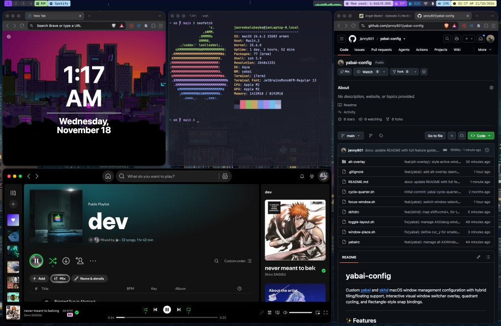
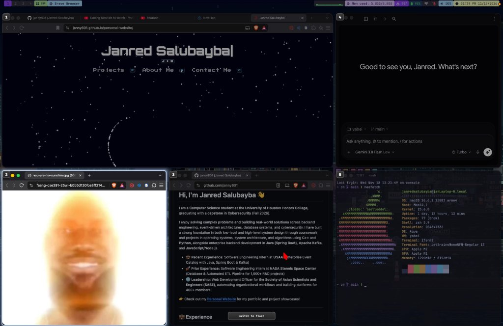

# yabai-config

Custom **[yabai](https://github.com/koekeishiya/yabai)** and **[skhd](https://github.com/koekeishiya/skhd)** macOS window management configuration with hybrid tiling/floating support, interactive visual window switcher overlay, quadrant cycling, and Rectangle-style snap bindings.

<p align="center">
  
</p>

---

## ✨ Features

### 1. Interactive Visual Window Switcher (`Alt` / `Option` Overlay)
<p align="center">
  
</p>

- **Hold `Alt` / `Option`**:
  - Dims the screen (40% transparent backdrop).
  - Highlights currently focused window with a **Nord/Hyprland-inspired soft ice-blue ambient glow** (`#94B3DC`).
  - Displays compact numbered badges (`1`, `2`, `3` ...) in the top-left corner of each visible window (ordered spatially top-to-bottom, left-to-right).
  - Displays a clean mechanical spacebar HUD at the bottom indicating layout toggle action (`switch to bsp` / `switch to float`).
- **Press `1` – `9`**: Focuses that window immediately. Focus state and glow update instantly without needing to release `Alt`.
- **Press `Space` while holding `Alt`**: Toggles layout between `bsp` and `float` on the fly.
- **Release `Alt`**: Dismisses overlay smoothly if no key is pressed.

### 2. Seamless BSP $\leftrightarrow$ Float Layout Toggle (`Alt + Space`)
- **Float Mode (Default)**: Windows float freely and can be placed using snap hotkeys.
- **BSP Mode (Tiling)**:
  - Automatically unfloats and tiles all standard windows, including apps with dialog subroles (e.g. `Messages`, `FaceTime`, `Spotify`).
  - Preserves spatial positions of windows when switching back and forth.
  - Automatically balances all window sizes evenly across the space.

### 3. Directional Snap & Split Controls (Works in both Float and BSP)
- When in **Float Mode**: snaps the active window to fractions of the screen.
- When in **BSP Mode**: warps/swaps the active window into the target direction slot and automatically re-balances adjacent windows so all windows fit evenly.

| Hotkey | Action | Description |
| :--- | :--- | :--- |
| `Shift + Cmd + J` | **Left Half** | Snaps to left half / warps left in BSP |
| `Shift + Cmd + K` | **Right Half** | Snaps to right half / warps right in BSP |
| `Shift + Cmd + ,` | **Top Half** | Snaps to top half / warps up in BSP |
| `Shift + Cmd + .` | **Bottom Half** | Snaps to bottom half / warps down in BSP |
| `Shift + Cmd + Up` | **Maximize** | Fullscreen toggle (`zoom-fullscreen` in BSP) |
| `Shift + Cmd + \` | **Smallest Size** | Shrinks window to minimum allowable bounds |
| `Ctrl + Alt + Shift + Up` | **Maximize Height** | Full height keeping existing width & X position |
| `Ctrl + Alt + C` | **Center** | Centers window on the active display |
| `Ctrl + Alt + D` | **First Third** | Left 1/3 of display |
| `Ctrl + Alt + F` | **Center Third** | Center 1/3 of display |
| `Shift + Cmd + L` | **Last Third** | Right 1/3 of display |
| `Shift + Cmd + U` | **First Two-Thirds** | Left 2/3 of display |
| `Shift + Cmd + I` | **Last Two-Thirds** | Right 2/3 of display |
| `Shift + Cmd + Down` | **Make Smaller** | Shrinks window bounds |
| `Ctrl + Alt + =` | **Make Larger** | Expands window bounds |

### 4. Direct Window Focus by Number
| Hotkey | Action |
| :--- | :--- |
| `Alt + 1` | Focus 1st window (top-left) |
| `Alt + 2` | Focus 2nd window |
| `Alt + 3` | Focus 3rd window |
| `Alt + 4` | Focus 4th window |
| `Alt + 5` | Focus 5th window |
| `Alt + 6` .. `9` | Focus 6th through 9th window |

### 5. Clockwise Quarter Cycling (`Ctrl + I`)
- Cycles focused window across the 4 corners:
  `Top-Left` $\rightarrow$ `Top-Right` $\rightarrow$ `Bottom-Right` $\rightarrow$ `Bottom-Left`.

---

## 📋 Prerequisites

```bash
# Install dependencies
brew install yabai skhd jq

# Start background services
yabai --start-service
skhd --start-service
```

> **Important**: Grant Accessibility permissions to `yabai`, `skhd`, and `alt-overlay` in **System Settings > Privacy & Security > Accessibility**.

---

## ⚙️ Installation & Setup

1. **Clone the repository:**
   ```bash
   git clone https://github.com/janny801/yabai-config.git ~/projects/config/yabai
   cd ~/projects/config/yabai
   ```

2. **Compile the `alt-overlay` helper:**
   ```bash
   swiftc -O alt-overlay/main.swift -o alt-overlay/alt-overlay
   ```

3. **Symlink configs to `~/.config`:**
   ```bash
   mkdir -p ~/.config/yabai ~/.config/skhd
   ln -sfn "$(pwd)/yabairc" ~/.config/yabai/yabairc
   ln -sfn "$(pwd)/skhdrc" ~/.config/skhd/skhdrc
   ln -sfn "$(pwd)/window-place.sh" ~/.config/yabai/window-place.sh
   ln -sfn "$(pwd)/toggle-layout.sh" ~/.config/yabai/toggle-layout.sh
   ln -sfn "$(pwd)/focus-window.sh" ~/.config/yabai/focus-window.sh
   ln -sfn "$(pwd)/cycle-quarter.sh" ~/.config/yabai/cycle-quarter.sh
   ln -sfn "$(pwd)/alt-overlay" ~/.config/yabai/alt-overlay
   ```

4. **Restart services:**
   ```bash
   yabai --restart-service
   skhd --reload
   ```

---

## 🔧 Service Management

| Action | Command |
| :--- | :--- |
| **Restart Yabai** | `yabai --restart-service` |
| **Restart SKHD** | `skhd --restart-service` |
| **Reload SKHD config** | `skhd --reload` |
| **Restart Overlay** | `killall alt-overlay; nohup ~/.config/yabai/alt-overlay/alt-overlay >/dev/null 2>&1 &` |
